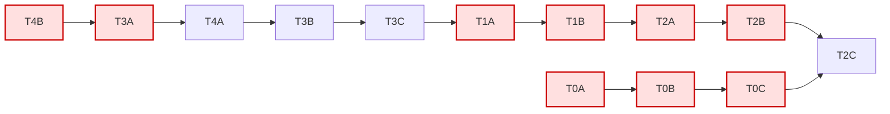

# Implementation Plan: Oloz Experience, Onboarding, UI Polish & Native Reel Tracking Fix

## 1. Bug Report & Requirements Analysis

- **Bug 1: Reel Counting is Not Working**
  - **Root Cause Analysis:**
    1. `OlozAccessibilityService` was not enabled in Android Accessibility settings on the device (`enabled_accessibility_services` was null).
    2. Even when enabled, `notifyReelDetected` only pushed to Flutter's `eventSink`. When Oloz is in the background while the user scrolls Instagram/YouTube, the Flutter Dart isolate can be paused or `eventSink` is disconnected, causing detected reels to be dropped completely.
    3. `ReelDetector` had brittle surface marker matching (`clips_viewer` / class name containing `"Reel"`) that fails on modern obfuscated Instagram (`InstagramMainActivity`) and YouTube Shorts, causing `isSurfaceActive` to be false or toggled off on activity transitions.
    4. Accessibility events were dispatched on the system background thread, which can fail silently on Flutter `eventSink`.
  - **Solution:**
    - Enable robust heuristics for reel scroll detection (vertical swipe on full-screen media containers in target apps with configurable dwell time).
    - **Direct Native SQLite Persistence:** Native `OlozAccessibilityService` writes detected reels directly into `app_flutter/oloz.sqlite` table `reel_events`. This guarantees zero dropped reels even when Oloz is backgrounded or killed.
    - Synchronously update `TrackingForegroundService` persistent notification (`Oloz · R: {count} · T: {time}`) on every single counted reel.
    - Post to Flutter `eventSink` safely on `Handler(Looper.getMainLooper())` for live UI reaction when app is open.

- **Requirement 2: First-Run Onboarding Flow**
  - Simple Permissions Menu (Usage Access, Accessibility, Notification) -> Customizer -> Daily Goal limits -> Break Reminder setup -> Mark onboarding complete.

- **Requirement 3: Component Gallery**
  - Fix `RenderFlex overflowed by 7.3 pixels` in `gallery_screen.dart`.
  - Relocate Component Gallery link from Home header into **Settings → Diagnostics & Data**.

- **Requirement 4: Motion & Transitions**
  - Smooth page transitions in `GoRouter` (FadeThrough / SlideUp).
  - Animated ring transitions and tweened counter numbers.

- **Requirement 5: Background Layouts**
  - Replace sterile flat backgrounds with subtle atmospheric ambient gradients (soft Indigo `#5870C2` and Peach `#F0A98E` radial glows) with high contrast and zero GPU drag.

- **Requirement 6: Clean Settings (Remove Fake Sync & Account)**
  - Remove fake Windows PC sync card and fake account synced badge. Replace with transparent on-device storage stats (SQLite/Drift database, 100% offline & private).

- **Requirement 7: Check for Updates on Version Click**
  - Tapping "Version 1.0.0+1" triggers checking modal with current status ("You're on the latest release: v1.0.0+1").

- **Requirement 8: Proactive Break Reminder**
  - Prompt user to set break reminder during onboarding and on Home.

- **Requirement 9: Background Overlay Scope**
  - Do NOT show floating pill on screen when app is minimized. The persistent notification bar (`Oloz · R: , T:`) is the sole background indicator.

- **Requirement 10: Clean Header**
  - Remove circular logo container beside the "Oloz" title in the top app bar.

---

## 2. Goal Tree

```mermaid
graph TD
  G[Goal: Oloz UX, Onboarding, Polish & Reel Detection Fix] --> E0[Epic 0: Native Reel Detection & Persistence Engine]
  G --> E1[Epic 1: First-Run Onboarding Sequence]
  G --> E2[Epic 2: Motion, Transitions & Ambient Backgrounds]
  G --> E3[Epic 3: Settings Clean-up & Header Polish]
  G --> E4[Epic 4: Gallery Fixes & Background Overlay Scope]

  E0 --> T0A[T0A Robust Reel Swipe Heuristics in ReelDetector]
  E0 --> T0B[T0B Direct Native SQLite Insert into oloz.sqlite]
  E0 --> T0C[T0C Live Notification Increment on Reel Detected]

  E1 --> T1A[T1A Onboarding Router Gate & Local Storage Flag]
  E1 --> T1B[T1B Simple Permissions, Customizer, Goal & Break Reminder Steps]

  E2 --> T2A[T2A Smooth GoRouter Page Transitions]
  E2 --> T2B[T2B Ambient Soft Gradient Backgrounds]
  E2 --> T2C[T2C Animated Ring & Counter Tweens]

  E3 --> T3A[T3A Remove Concentric Logo Beside Oloz Title]
  E3 --> T3B[T3B Remove Fake Sync Cards; Add Real SQLite Storage Info]
  E3 --> T3C[T3C Check for Updates Dialog on Version Tap]

  E4 --> T4A[T4A Fix Gallery 7.3px Overflow & Move to Diagnostics]
  E4 --> T4B[T4B Remove Auto Floating Pill on Exit; Keep Notification]
```

---

## 3. Dependency Graph

---

## 4. Execution Table

| # | Task | Files To Change | Verification Check | Status |
|---|------|-----------------|---------------------|--------|
| 1 | **Native Reel Detection & Direct SQLite Persistence** | `OlozAccessibilityService.kt`, `ReelDetector.kt`, `TrackingBridge.kt` | Scrolling Instagram/Shorts writes to `oloz.sqlite` and updates notification bar live | todo |
| 2 | **Disable Auto Screen Overlay on Exit** | `lib/app/app.dart`, `TrackingBridge.kt` | Minimizing app updates persistent notification without overlaying floating pill | todo |
| 3 | **Remove Logo Beside Oloz Title** | `lib/features/home/home_screen.dart` | Clean typography header without circular concentric mark | todo |
| 4 | **Fix Gallery 7.3px Overflow & Relocate Link** | `gallery_screen.dart`, `home_screen.dart`, `settings_screen.dart` | 0 layout overflows; accessible via Settings -> Diagnostics | todo |
| 5 | **Clean Settings (Remove Fake Sync, Add Version Check)** | `settings_screen.dart` | Real local SQLite stats; interactive update check modal on version tap | todo |
| 6 | **First-Run Onboarding & Break Reminder Flow** | `router.dart`, `welcome_screen.dart`, `permission_screen.dart`, `goal_screen.dart` | New install launches Permissions -> Customizer/Goal -> Reminder -> Home | todo |
| 7 | **Ambient Backgrounds & Motion Transitions** | `responsive_shell.dart`, `router.dart`, `oloz_colors.dart` | Soft calm ambient backdrop; smooth fade/slide page transitions | todo |
